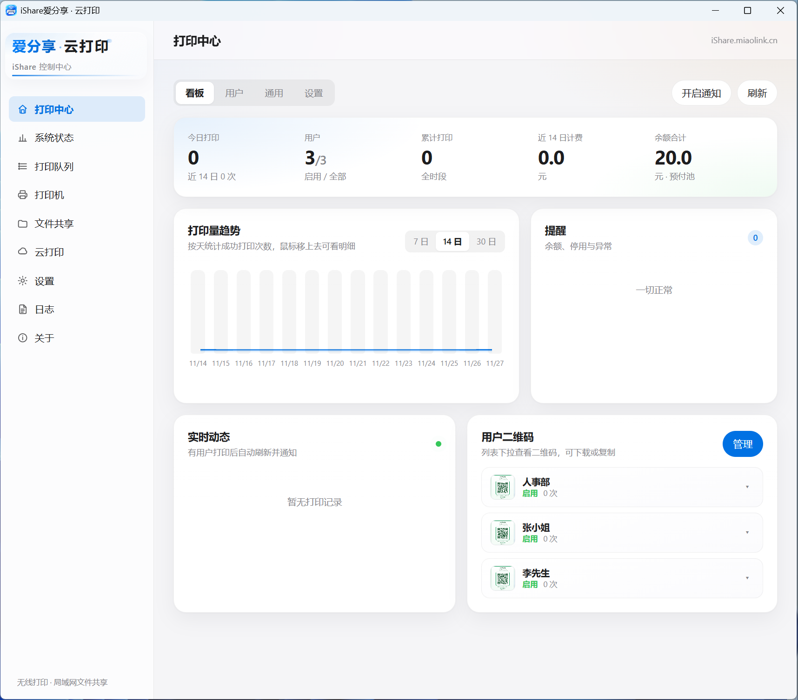
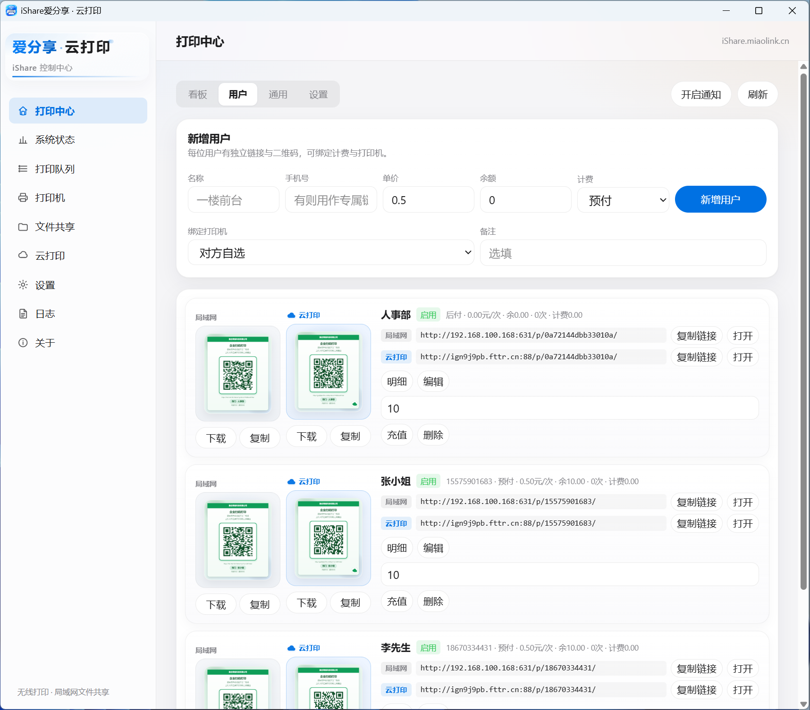
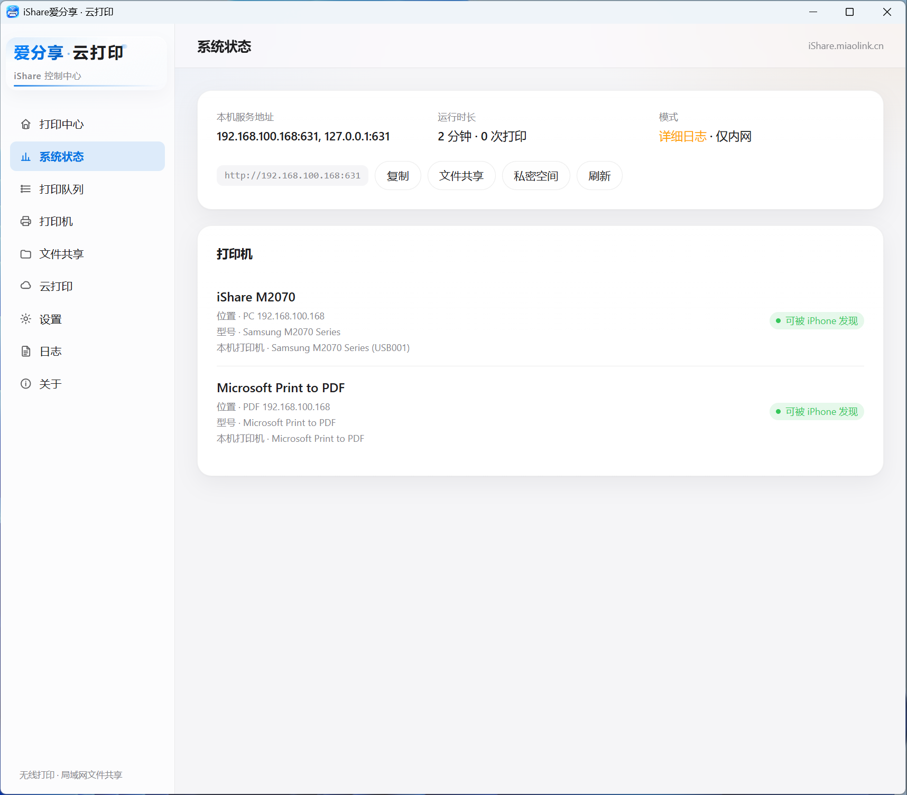

# iShare · 爱分享·云打印

**私有文件共享与 AirPrint 隔空打印服务中心**（Windows）

本仓库**仅发布安装包与产品说明**，**不提供源代码**。软件版权归 Allinpol / 长沙融合网络科技有限公司所有，见 [LICENSE](LICENSE)。

官网：[iShare.miaolink.cn](https://iShare.miaolink.cn)

---

## 下载

请到 **[Releases](../../releases)** 下载最新安装包：

| 文件 | 说明 |
|------|------|
| `iShare-amd64-installer.exe` | Windows x64 正式安装程序（推荐） |

安装后开始菜单 / 桌面会出现「iShare 爱分享·云打印」。首次运行会在安装目录生成配置示例。

> 部分杀毒软件可能误报未知发布者。请以本仓库官方 Release 为准；若提示拦截，请加入信任后安装。

---

## 免费版说明

本仓库发布的安装包为**免费版**，个人日常使用基本满足。

| 项目 | 说明 |
|------|------|
| 适用 | 个人 / 家庭日常打印 |
| 额度 | **单日最多 50 页**（网页打印 + 隔空打印合计，按自然日清零） |
| 超额 | 超过 50 页视为**商用**，需联系作者授权后使用 |
| 软件内 | 控制中心侧栏「许可」可查看今日已用 / 剩余页数 |

商用、门店、企业批量场景请联系：**18670334431** 或 [iShare.miaolink.cn](https://iShare.miaolink.cn)

---

## 功能一览

| 能力 | 说明 |
|------|------|
| 隔空打印 | 本机打印机 → iPhone / iPad / Mac AirPrint |
| 网页扫码打印 | 拖放 PDF / 图片 / Office，选打印机即打 |
| 用户与计费 | 专属链接 + 二维码，预付/后付、充值明细 |
| 打印图模版 | 打印店 / 私人 / 公司三套海报，可改文案配色 |
| 云打印 | 无公网 IP 也能外网扫码送印（通道不存文件） |
| 文件共享 | 公开目录 + 私密空间，浏览 / 预览 / 下载 / ZIP |
| 桌面控制中心 | 托盘常驻，看板、队列、设置、日志一站管理 |

---

## 打印中心

看板统计今日打印、用户数、余额与近 14 日趋势；下方可快速查看各用户二维码。

为前台、部门或客户新建用户：每人独立局域网 / 云打印链接与二维码，可绑定打印机、单价与预付余额。

内网打印可「公开可用」，云打印默认「凭分享进入」；通用页鉴权令牌、有效期与局域网/云二维码一并管理。

---

## 打印图模版

三套场景模版（打印店 / 私人 / 公司），自定义标题、说明、页脚与配色，右侧实时预览海报。

海报效果示例：

  
  &nbsp;
  
  &nbsp;
  

---

## 隔空打印（AirPrint）

在「打印机」勾选本机队列、设置手机显示名称与黑白/彩色类型后保存；同一 Wi‑Fi 下 iPhone 即可发现并打印。

系统状态可查看服务地址、运行时长，以及哪些队列「可被 iPhone 发现」。

手机隔空打印选中本机队列示例：

  

---

## 网页扫码打印

浏览器打开打印页：选择打印机，拖放或点选文件（PDF / 图片 / Word·Excel·PPT，单文件 ≤ 64 MB），点「开始打印」。

公开首页可浏览共享目录，并一键跳转打印页、私密空间或服务中心。

---

## 文件共享

- **公开共享**：多目录映射，英文 slug 做链接、中文名仅展示；可限制仅局域网访问  
- **私密空间**：账号密码登录，支持超时与换网重登  

---

## 云打印

一键激活后，外网手机/电脑通过专属网址把作业送到本机出纸；云端只做转发，不保存、不查看文件内容。

---

## 设置与关于

绑定本机 IP / 网卡，仅内网、默认黑白、开机自启、托盘隐藏、作业通知等。

---

## 系统要求

- Windows 10 / 11（64 位）
- 建议安装 [Microsoft Edge WebView2 运行时](https://developer.microsoft.com/microsoft-edge/webview2/)（安装包会检测并引导）
- 网页打印 Office 文档需本机已安装对应 Microsoft Office

---

## 快速开始

1. 从 [Releases](../../releases) 下载并运行安装包  
2. 启动 **iShare**，在「打印机」勾选要共享的队列并保存  
3. 手机与电脑同一局域网 → 隔空打印中即可看到打印机  
4. 「打印中心」建用户或下载通用二维码 → 扫码网页打印  
5. 需要外网时，在「云打印」一键激活并复制云地址  

---

## 许可与所有权

Copyright © Allinpol / 长沙融合网络科技有限公司. **All rights reserved.**

- 可免费下载；免费版含单日 50 页额度，适合个人日常  
- 超额或商用须取得作者授权  
- **不开源**；禁止未经授权的再分发、破解与反向工程  
- 完整条款见 [LICENSE](LICENSE)

---

## 反馈

问题与建议请提交 [Issues](../../issues)，或通过「关于」页客服企微联系。
