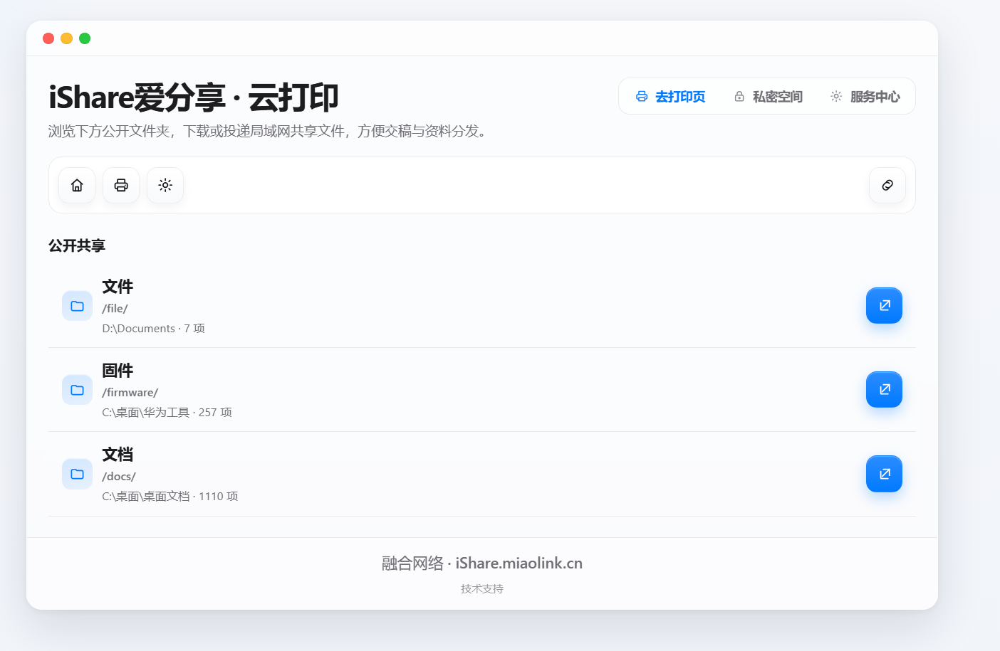
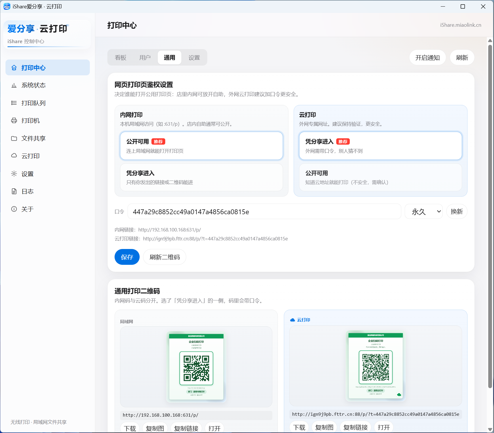

# iShare · 爱分享·云打印

**让普通 USB / 网线打印机支持 iPhone、iPad、Mac 隔空打印（AirPrint）**  
同时提供扫码网页打印、局域网文件共享与云打印 —— Windows 一站式私有打印与文件发布工具。

> 关键词：AirPrint 隔空打印 · 无 Wi‑Fi 打印机 · iPhone 无线打印 · USB 打印机共享 · 扫码打印 · 局域网文件共享 · 云打印

本仓库**仅发布安装包与产品说明**，**不提供源代码**。版权归 Allinpol / 长沙融合网络科技有限公司，见 [LICENSE](LICENSE)。  
官网：[iShare.miaolink.cn](https://iShare.miaolink.cn) · 下载见下方 [Releases](../../releases)

---

## About · 为什么选 iShare

很多家庭和门店的打印机**本身没有 Wi‑Fi**，只连在 Windows 电脑上（USB 或网线），苹果手机、iPad、Mac 的「隔空打印」里根本搜不到。买一台带 AirPrint 的新机贵，换整套设备也不值。

**iShare 的最大优势：把电脑上的普通打印机，变成苹果全生态都能用的隔空打印设备。**

| 痛点 | iShare 怎么解决 |
|------|----------------|
| 打印机没有 Wi‑Fi / 不支持 AirPrint | 电脑装上 iShare，勾选本机队列 → iPhone / iPad / Mac 同一局域网即可发现并打印 |
| 想用手机打 PDF、照片、作业、合同 | 扫码打开网页打印页，拖入文件即可出纸（PDF / 图片 / Word·Excel·PPT） |
| 要在局域网发资料、交稿、发固件 | 公开文件夹一键发布，同事扫码或点链接浏览、预览、下载、打包 ZIP |
| 人不在店里 / 没有公网 IP | 可选云打印通道，外网手机也能送到本机打印机（通道不存文件） |

一句话：**一台 Windows + 现有打印机 = 苹果隔空打印 + 网页送印 + 文件分享发布。**

适合：家庭、宿舍、文具店自助打印、前台接待、中小办公室、培训机构等。

  

<em>iPhone「打印机」列表中出现本机队列 —— 即使打印机本身没有无线网卡</em>

---

## 下载（免费版）

请到 **[Releases](../../releases/latest)** 下载最新安装包：

| 文件 | 说明 |
|------|------|
| `iShare-amd64-installer.exe` | Windows x64 正式安装程序（推荐） |

安装后开始菜单 / 桌面为「iShare 爱分享·云打印」。

> 部分杀毒可能提示未知发布者。请以本仓库官方 Release 为准；拦截时加入信任即可。

### 免费版额度

| 项目 | 说明 |
|------|------|
| 适用 | 个人 / 家庭日常 |
| 额度 | **单日最多 50 页**（隔空打印 + 网页打印合计，自然日清零） |
| 超额 | 视为商用，需联系作者授权 |
| 软件内 | 侧栏「许可」查看今日已用 / 剩余 |

商用 / 门店 / 企业：**18670334431** · [iShare.miaolink.cn](https://iShare.miaolink.cn)

---

## 三大核心能力

### 1. 隔空打印（AirPrint）—— 普通打印机接入苹果生态

把接在 Windows 上的 **USB / 有线网络打印机** 共享为 AirPrint 服务。手机与电脑连同一 Wi‑Fi，打开隔空打印即可看到「可被 iPhone 发现」的队列，无需打印机自带无线、无需换苹果认证机型。

### 2. 扫码 / 网页打印 —— 手机传文件就出纸

浏览器打开打印页：选打印机，拖放或点选文件（PDF、图片、Word / Excel / PPT，单文件 ≤ 64 MB）。可为前台、客户生成专属链接与二维码，支持预付计费与打印明细。

  
  &nbsp;
  
  &nbsp;
  

### 3. 公共文件分享发布 —— 局域网资料中心

把本机文件夹映射为公开链接：浏览、在线预览、下载、文件夹 ZIP；可限制仅局域网访问。另有账号密码保护的私密空间，方便交稿与内部分发。

---

## 更多能力

| 能力 | 说明 |
|------|------|
| 打印中心看板 | 今日打印、用户、余额、近 14 日趋势 |
| 鉴权与二维码 | 内网可公开；云打印默认凭分享进入 |
| 云打印 | 无公网 IP 也能外网扫码送印（只转发、不存文件） |
| 桌面控制中心 | 托盘常驻：队列、打印机、共享、设置、日志、许可 |

---

## 快速开始（3 步实现苹果隔空打印）

1. 从 [Releases](../../releases/latest) 安装并启动 **iShare**  
2. 打开「打印机」，勾选要共享的本机队列并保存（可改手机上显示的名称、黑白/彩色）  
3. iPhone / iPad / Mac 与电脑同一局域网 → **隔空打印** 中选择该打印机  

接着可在「打印中心」下载扫码海报，或在「文件共享」发布公开文件夹。需要外网时，到「云打印」一键激活。

---

## 系统要求

- Windows 10 / 11（64 位）
- 建议安装 [Microsoft Edge WebView2](https://developer.microsoft.com/microsoft-edge/webview2/)（安装包会检测）
- 网页打印 Office 文档需本机已安装 Microsoft Office

---

## FAQ

**Q：打印机没有 Wi‑Fi，能给 iPhone 隔空打印吗？**  
可以。打印机接到装有 iShare 的 Windows 电脑即可，手机搜到的是电脑上的 AirPrint 服务。

**Q：和买一台原生 AirPrint 打印机有什么区别？**  
iShare 复用你现有的 USB / 网线打印机，额外提供扫码网页打印和局域网文件发布，不必为「能隔空打」单独换机。

**Q：文件会不会上传到云端？**  
局域网打印与共享都在本地完成。云打印通道只做转发，**不保存、不查看**文件内容。

**Q：免费版有什么限制？**  
个人日常免费；单日合计超过 **50 页** 视为商用，需联系作者授权。

---

## 许可与所有权

Copyright © Allinpol / 长沙融合网络科技有限公司. **All rights reserved.**

- 可免费下载；免费版含单日 50 页额度  
- 超额或商用须取得作者授权  
- **不开源**；禁止未经授权的再分发、破解与反向工程  
- 完整条款见 [LICENSE](LICENSE)

---

## 反馈

[Issues](../../issues) · 软件内「关于」页客服企微 · 电话 18670334431
