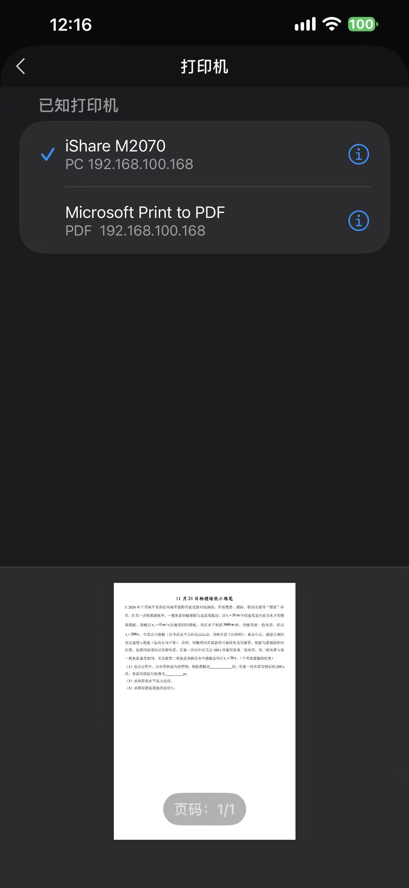
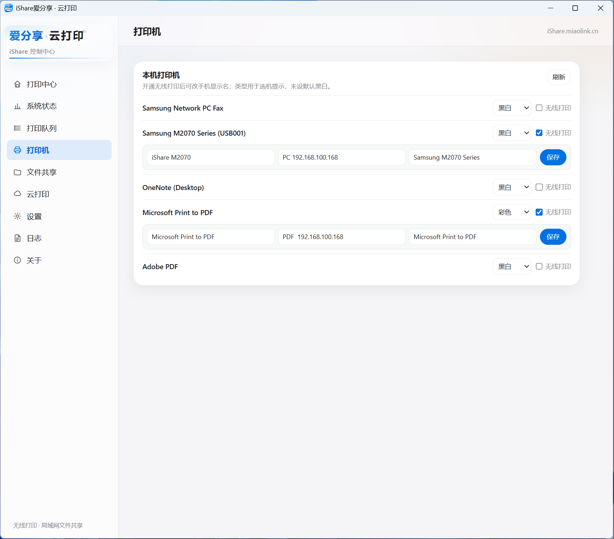
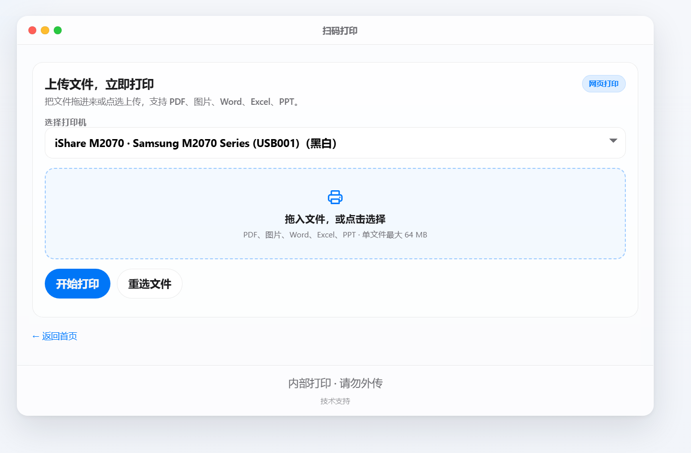
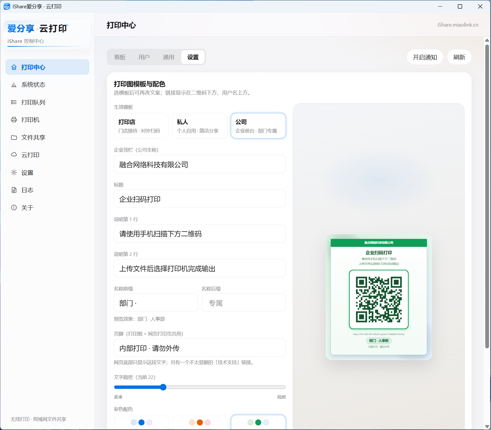
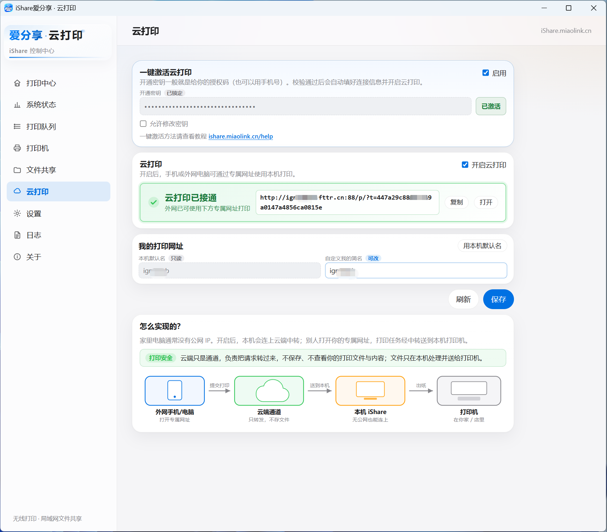
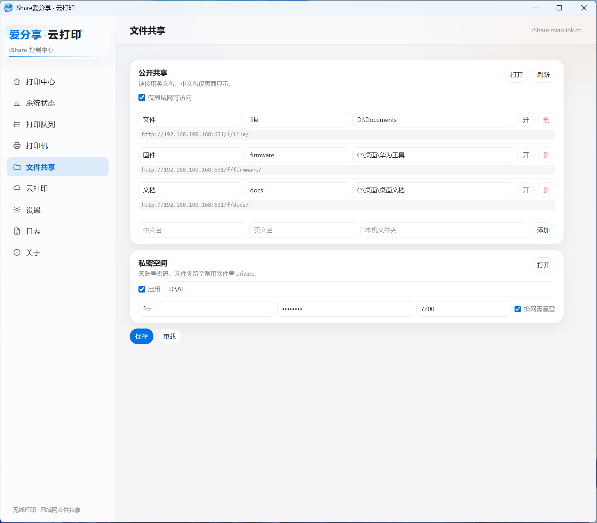
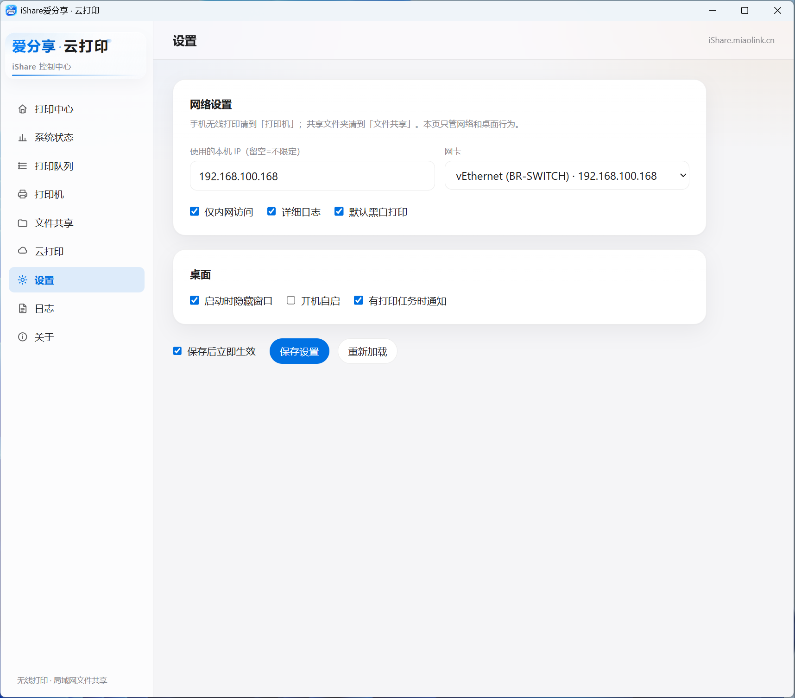
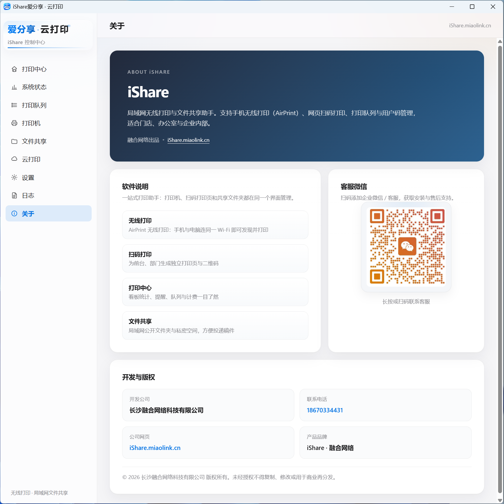

# iShare · 爱分享·云打印

**让普通 USB / 网线打印机支持 iPhone、iPad、Mac 隔空打印（AirPrint）**  
**一人一码网页在线打印 · 统计计费 · 分享链接远程送印 · 局域网文件发布**  
Windows 一站式私有打印与文件共享工具，门店与办公室都能用。

> 关键词：AirPrint 隔空打印 · 无 Wi‑Fi 打印机 · iPhone 无线打印 · USB 打印机共享 · 一人一码 · 网页在线打印 · 扫码打印 · 打印计费统计 · 远程打印 · 云打印 · 局域网文件共享

本仓库**仅发布安装包与产品说明**，**不提供源代码**。版权归 Allinpol / 长沙融合网络科技有限公司，见 [LICENSE](LICENSE)。  
官网：[iShare.miaolink.cn](https://iShare.miaolink.cn) · 下载见下方 [Releases](../../releases)

---

## About · 为什么选 iShare

很多家庭和门店的打印机**本身没有 Wi‑Fi**，只连在 Windows 电脑上（USB 或网线），苹果手机、iPad、Mac 的「隔空打印」里根本搜不到。买一台带 AirPrint 的新机贵，换整套设备也不值。

**最大优势：把电脑上的普通打印机，变成苹果全生态都能用的隔空打印设备。**  
**同时：一人一码网页在线打印、按人统计计费、把专属链接分享给用户远程送印。**

| 你要什么 | iShare 怎么做 |
|----------|---------------|
| 无 Wi‑Fi 打印机也能隔空打印 | 勾选本机队列 → iPhone / iPad / Mac 同一局域网即可发现并打印 |
| **一人一码** | 每位客户 / 前台 / 部门独立链接与二维码，互不串用 |
| **网页在线打印** | 手机浏览器打开打印页，拖入 PDF / 图片 / Office 即可出纸，不用装 App |
| **统计计费** | 看板看今日打印、余额、趋势；支持预付 / 后付、充值与打印明细 |
| **分享远程打印** | 把专属码或云打印链接发给用户，对方在外网也能送到你店里的打印机 |
| 局域网发资料 | 公开文件夹一键发布：浏览、预览、下载、ZIP；另有私密空间 |

一句话：**一台 Windows + 现有打印机 = 苹果隔空打印 + 一人一码网页打印 + 计费统计 + 远程分享送印 + 文件发布。**

适合：家庭、宿舍、**文具店自助打印**、前台接待、中小办公室、培训机构、企业内部打印点等。

  

<em>iPhone「打印机」列表中出现本机队列 —— 即使打印机本身没有无线网卡</em>

---

## 下载（免费版）

请到 **[Releases](../../releases/latest)** 下载最新安装包：

| 文件 | 说明 |
|------|------|
| `iShare-amd64-installer.exe` | Windows x64 正式安装程序（推荐） |

安装后开始菜单 / 桌面为「iShare 爱分享·云打印」。

> 部分杀毒可能提示未知发布者。请以本仓库官方 Release 为准；拦截时加入信任即可。

### 个人完全免费（≤50 页/日）

**个人完全免费**：单日不超过 **50 页**（隔空打印 + 网页打印合计），**99% 的个人用户足够使用**。

| 项目 | 说明 |
|------|------|
| 个人免费 | 单日 ≤ 50 页即完全免费 |
| 说明 | 单日不超过 50 页；99% 的个人用户足够使用 |
| 超额 | 超过 50 页按商用处理，请联系作者授权 |
| 软件内 | 侧栏「许可」查看今日已用 / 剩余 |

商用 / 门店 / 企业：**18670334431** · [ishare.miaolink.cn](https://ishare.miaolink.cn/)

### 其他平台定制

公开 Releases 目前提供 **Windows x64** 安装包。

如需 **macOS**、**Linux** 或 **OpenWrt 专用版**，可联系作者按场景定制（功能范围与交付方式面议）。

联系：**18670334431** · [ishare.miaolink.cn](https://ishare.miaolink.cn/) · 软件内「关于」页客服企微

---

## 四大核心能力

### 1. 隔空打印（AirPrint）—— 普通打印机接入苹果生态

把接在 Windows 上的 **USB / 有线网络打印机** 共享为 AirPrint 服务。手机与电脑连同一 Wi‑Fi，打开隔空打印即可看到「可被 iPhone 发现」的队列，无需打印机自带无线、无需换苹果认证机型。

### 2. 一人一码 · 网页在线打印 · 统计计费

**一人一码**：在打印中心为客户 / 前台 / 部门新建用户，每人独立局域网链接、云打印链接与二维码；可绑定指定打印机，海报可下载张贴。

**网页在线打印**：对方用手机浏览器打开专属页（或通用打印页），拖入 PDF、图片、Word / Excel / PPT（单文件 ≤ 64 MB）即可送印，**不用装 App**。

**统计计费**：看板汇总今日打印、用户数、余额与近 14 日趋势；支持预付 / 后付、充值、打印明细与异常提醒，门店自助打印也好对账。

  
  &nbsp;
  
  &nbsp;
  

### 3. 分享给用户远程打印（云打印）

把专属码、通用打印链接或云地址发给用户：对方不在店内、没有连你的 Wi‑Fi，也能通过手机把文件送到本机打印机。无公网 IP 也可一键开通；云端**只做转发，不保存、不查看**文件内容。云打印默认可「凭分享进入」，避免陌生人乱打。

### 4. 公共文件分享发布 —— 局域网资料中心

把本机文件夹映射为公开链接：浏览、在线预览、下载、文件夹 ZIP；可限制仅局域网访问。另有账号密码保护的私密空间，方便交稿与内部分发。

---

## 控制中心一览

桌面托盘常驻：打印中心、队列、打印机、共享、云打印、设置、日志、许可、关于。

---

## 快速开始

1. 从 [Releases](../../releases/latest) 安装并启动 **iShare**  
2. 「打印机」勾选本机队列并保存 → 手机同一 Wi‑Fi 即可 **隔空打印**  
3. 「打印中心」新增用户 → 下载 **一人一码** 海报，或复制链接给客户 **网页在线打印**  
4. 需要店外送印：开「云打印」，把链接 / 二维码 **分享给用户远程打印**；看板查看 **统计计费**  
5. 「文件共享」发布公开文件夹，方便交稿与资料分发  

---

## 系统要求

- Windows 10 / 11（64 位）
- 建议安装 [Microsoft Edge WebView2](https://developer.microsoft.com/microsoft-edge/webview2/)（安装包会检测）
- 网页打印 Office 文档需本机已安装 Microsoft Office

---

## FAQ

**Q：打印机没有 Wi‑Fi，能给 iPhone 隔空打印吗？**  
可以。打印机接到装有 iShare 的 Windows 电脑即可，手机搜到的是电脑上的 AirPrint 服务。

**Q：和买一台原生 AirPrint 打印机有什么区别？**  
iShare 复用你现有的 USB / 网线打印机，额外提供一人一码网页打印、计费统计、远程分享送印和局域网文件发布，不必为「能隔空打」单独换机。

**Q：什么是一人一码？**  
每个用户一条专属打印链接和二维码，可单独计费、绑打印机；适合门店客户或公司部门，互不影响。

**Q：用户不在店里能不能打？**  
可以。开通云打印后，把专属链接或二维码发给对方，即可远程网页送印到你店里的机器。

**Q：文件会不会上传到云端？**  
局域网打印与共享都在本地完成。云打印通道只做转发，**不保存、不查看**文件内容。

**Q：个人用户要收费吗？**  
个人完全免费：单日不超过 **50 页**，**99% 的个人用户足够使用**。超过按商用处理，门店 / 企业请联系授权。

**Q：有 macOS / Linux / OpenWrt 版本吗？**  
公开下载目前为 Windows 版。macOS、Linux 以及 OpenWrt 专用版可按需定制，请联系作者。

---

## 许可与所有权

Copyright © Allinpol / 长沙融合网络科技有限公司. **All rights reserved.**

- **个人完全免费**（单日 ≤ 50 页）  
- 超额按商用处理，须取得作者授权  
- **不开源**；禁止未经授权的再分发、破解与反向工程  
- 完整条款见 [LICENSE](LICENSE)

---

## 反馈

[Issues](../../issues) · 软件内「关于」页客服企微 · 电话 18670334431
